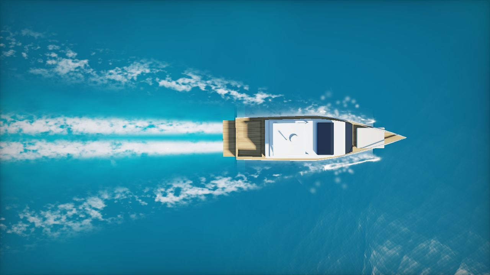
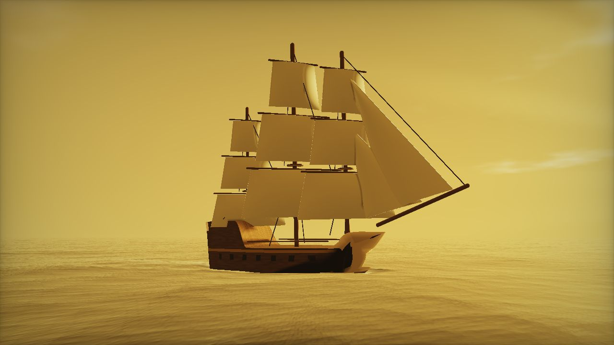
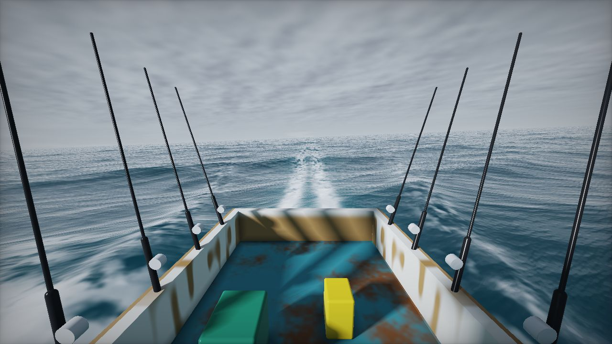
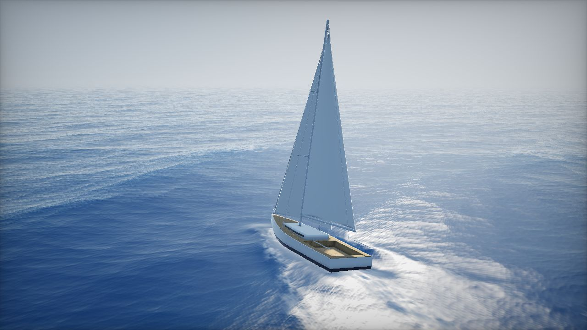

# Ocean Run: live wallpaper

A relaxing, cinematic ocean scene for your laptop, with boats you can swap. The boat stays in place on screen and only rocks and shudders on the swell, while the sea streams past underneath it, cut into a white wake.

The whole animation is a **seamless loop** of 60 seconds by default, or 30 seconds with `?loop=30`. The last frame matches the first frame pixel for pixel, so it plays forever without a visible jump.

Inspired by [Noniv/web-ocean](https://github.com/Noniv/web-ocean). That project is a WebGPU FFT ocean that you fly around in. This one uses WebGL2 and needs no build step or server, so it also runs inside wallpaper apps and older browsers.

You can use **your own realistic 3D boat models** (`.glb`). Each boat slot uses its model when you add one, and falls back to the built-in boat when you don't. See [Use real 3D boat models](#use-real-3d-boat-models).

| Motor yacht, tropical, drone view | Galleon, golden hour, side view |
|---|---|
|  |  |
| **Fishing boat, overcast, deck view** | **Sailing yacht, clear day, chase view** |
|  |  |

## Boats, scenes and cameras

Everything can be mixed. Each boat starts with the scene and camera that suit it best.

| Boat (`boat=`) | Speed | Default scene | Default camera |
|---|---|---|---|
| `yacht`: motor yacht with flybridge, twin prop wash, bow spray | 12 m/s | `tropical` | `drone` |
| `galleon`: three-masted square-rigger with braced yards, jibs and rigging | 3.5 m/s | `golden` | `side` |
| `fishing`: workboat with a rusty deck, rods over the wake, cooler, jerrycan | 7 m/s | `overcast` | `deck` |
| `sailboat`: heeled sloop with mainsail and genoa | 4.5 m/s | `clear` | `chase` |

- **Scenes** (`scene=`): `tropical`, `golden`, `overcast`, `clear`, `sunset`, `storm` (with lightning), `night` (moonlight, stars and nav lights).
- **Cameras** (`view=`):
  - `chase`: behind and above.
  - `drone`: straight down.
  - `side`: abeam.
  - `deck`: on board and rocking with the boat. For the galleon, whose deck is surrounded by sails, `deck` is a close-up from the waterline instead.

## Use real 3D boat models

The built-in boats are simple shapes drawn in code. For realism, drop in real 3D models. The wallpaper places each one automatically:

- It turns the model so the bow faces forward. The bow is the narrow end of the hull.
- It scales the model to the boat's length.
- It sinks the model to its waterline. The water hides the hull below the surface, and the wake, foam and rocking fit the hull's measured size.
- The model is lit by the scene's sun and sky, casts shadows on itself, and its windows reflect the sky.

**1. Get models.** Good sources of realistic boats:

- **[Sketchfab](https://sketchfab.com/search?features=downloadable&type=models&q=yacht):** tick *Downloadable* and search "yacht", "galleon", "fishing boat" or "sailboat". Choose *glTF Binary (.glb)* when you download.
- **[Fab](https://www.fab.com)** and **[TurboSquid](https://www.turbosquid.com/Search/3D-Models/free/boat/glb)**: both have free and paid boats.

Check each licence. **CC-BY** models need credit, so add a line for each to `models/CREDITS.md`.

**2. Name them** `yacht.glb`, `galleon.glb`, `fishing.glb` or `sailboat.glb`, and put them in `models/`.

**3. Pack them** so they also work when the page is opened straight from disk, which is how wallpaper apps open it:

```
node tools/pack-models.mjs
```

This writes `models/models.js`. Run it again whenever you change a model. If you serve the folder over http instead (for example `npx serve`), the `.glb` files load directly and packing is optional.

**Quick try:** drag a `.glb` onto the open page. It replaces the current boat for that session.

**If a model sits wrong:**

| Problem | Fix |
|---|---|
| Too deep or too high in the water | Press `[` or `]` to sink or raise it 10 cm. The message shows the value to keep, for example `?waterline=1.4`. |
| Sailing backwards | `?flip=1` |
| Wrong size | `?length=24`, in metres from bow to stern |
| Very large file, or slow | Shrink it: `npx @gltf-transform/cli resize in.glb out.glb --width 2048 --height 2048`, then `npx @gltf-transform/cli meshopt out.glb small.glb` |
| Doesn't load (Draco compressed) | `npx @gltf-transform/cli copy in.glb out.glb` decodes it into a plain `.glb` |

## Run it

Open `index.html` in a browser. It is self-contained and works from `file://` with no server and no install.

| Key | Action |
|---|---|
| `B` | Next boat (switches to its default scene and camera) |
| `S` | Next sky and sea |
| `C` | Next camera |
| `F` | Fullscreen |
| `R` | Record exactly one loop to a `.webm` video, starting at the loop seam |
| `[` `]` | Sink or raise a 3D model by 10 cm |
| `H` | Show or hide the info overlay |

## Use it as your wallpaper

Point your wallpaper app at `index.html` with the options you like, for example `index.html?boat=galleon&scene=sunset`.

- **Windows:** [Lively Wallpaper](https://www.rocksdanister.com/lively/) (free). Choose *Add wallpaper*, then pick `index.html`, or paste the GitHub Pages URL.
- **macOS:** [Plash](https://sindresorhus.com/plash) (free). Add a website pointing at the file or the hosted URL.
- **Linux:** [Hidamari](https://github.com/jeffshee/hidamari) or Komorebi (web page mode). On KDE, use an HTML wallpaper plugin.
- **Video wallpaper apps:** press `R` and wait one loop. The saved `.webm` loops seamlessly in any player that repeats video, such as Wallpaper Engine, VLC, or Hidamari's video mode. For a crisp recording, open with `?scale=1` first.

## URL options

| Option | Default | Meaning |
|---|---|---|
| `boat` | `yacht` | `yacht`, `galleon`, `fishing` or `sailboat` |
| `scene` | depends on the boat | See the list of scenes above |
| `view` | depends on the boat | `chase`, `drone`, `side` or `deck` |
| `loop` | `60` | Loop length in seconds. Use 30 or 60, or anything from 10 to 300. |
| `speed` | depends on the boat | Boat speed in m/s, which sets how fast the sea streams past |
| `fps` | `60` | Frame-rate cap. Use `30` to save battery. |
| `scale` | auto | Render resolution relative to the screen. Leave unset for adaptive quality, or force it with values like `0.5` or `1`. |
| `fov` | depends on the camera | Vertical field of view in degrees |
| `exposure` | `1` | Brightness multiplier |
| `spray` | `1` | Bow spray multiplier. `0` turns it off. |
| `seed` | `7` | Different random sea |
| `grain` | `2` | Film grain strength. `0` turns it off. |
| `ui` | | `1` shows the overlay on start |
| `t`, `still` | | `t=12&still=1` renders one fixed frame, for screenshots |
| `waterline`, `flip`, `length` | | Placement of a 3D model; see [Use real 3D boat models](#use-real-3d-boat-models) |
| `model` | | `0` ignores the 3D models and uses the built-in boats |
| `cam`, `tgt` | | Camera position and look-at point, as `x,y,z` in metres (the boat heads +x) |

## How the seamless loop works

- **Waves:** the sea is a sum of 36 sharp-crested waves. Each wave's phase speed combines deep-water dispersion and the boat moving over it. That speed is rounded to a whole number of cycles per loop, so at `t = loop` every wave has returned to exactly where it started.
- **Boat motion:** heave, pitch and roll are sampled from those same waves under the hull, so the motion is periodic too. The deck camera rides on that motion. Engine vibration and the slow sway use whole-number frequencies per loop.
- **Spray:** each particle's lifetime divides the loop length exactly.
- **Foam and clouds:** whitecaps, wake foam, wake turbulence and clouds use noise that moves with the water. Two copies offset by one loop are cross-faded, which repeats with no seam.
- **Wake:** the bow wave, Kelvin wake arms and prop wash are fixed in the boat's frame, so they never break the loop.

## How it's drawn

Each frame takes three passes:

1. A full-screen ray-marched shader draws the ocean, the sky and, when there is no 3D model, the built-in boat. It writes colour and depth.
2. [three.js](https://threejs.org) draws the 3D model, spray and nav lights, depth-tested against the sea.
3. A final pass applies tone mapping and colour grading.

three.js is bundled in `vendor/three.bundle.js` as a plain script so it works offline and from disk. To rebuild it, run `cd tools && npm install && npm run build-three`.

## Performance

The ocean is a full-screen ray-marched shader. The resolution adapts automatically to hold a steady frame rate, and rendering pauses when the page is hidden. The galleon, with all its sails, is the heaviest boat. On a laptop with integrated graphics, try `?fps=30` or `?scale=0.6`.
