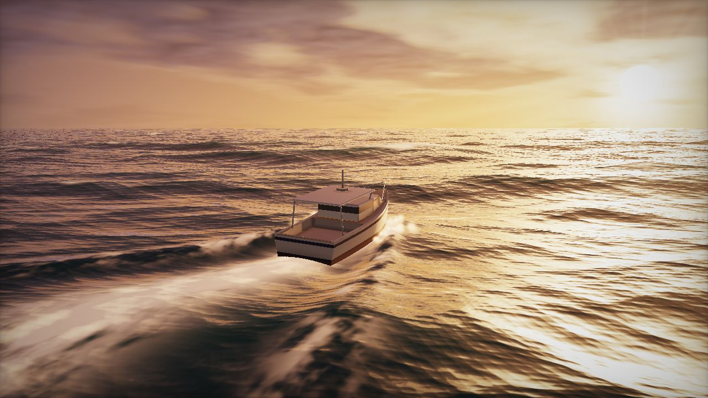
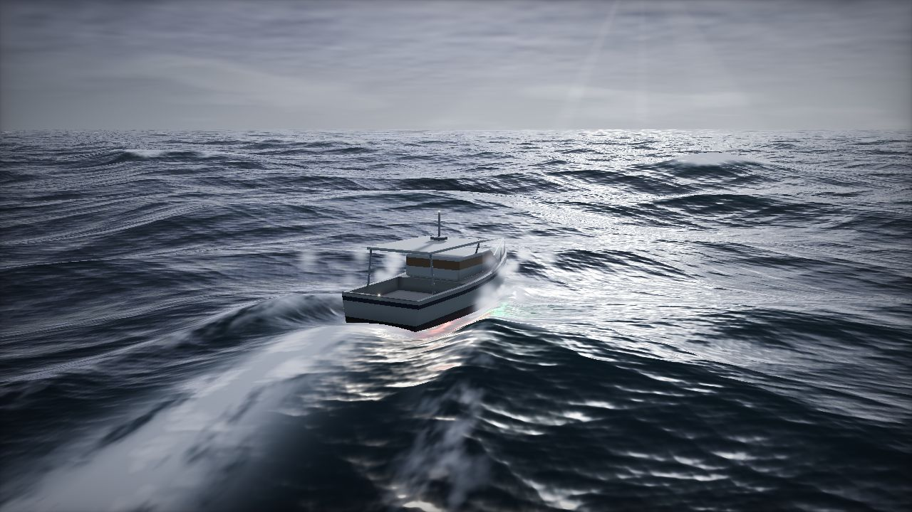
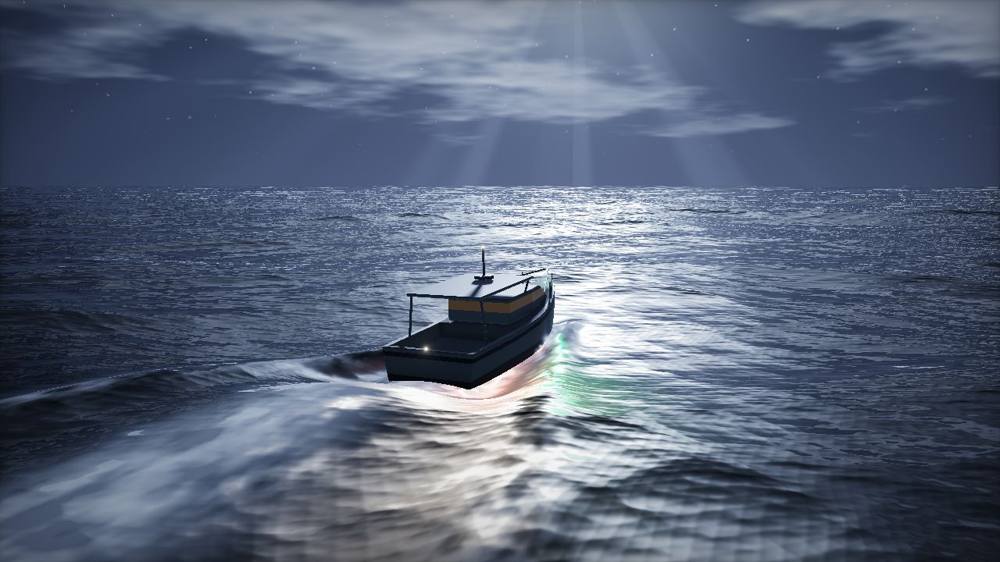

# Ocean Run: live wallpaper

A dramatic, relaxing ocean scene for your laptop. A small boat runs at speed toward a low sun and cuts through the sea, throwing spray from the bow and leaving a white wake. The boat stays in the same place on screen and only rocks and shudders on the swell, while the sea streams past underneath it.

The whole animation is a **seamless loop** of 60 seconds by default, or 30 seconds with `?loop=30`. The last frame matches the first frame pixel for pixel, so it plays forever without a visible jump.

Inspired by [Noniv/web-ocean](https://github.com/Noniv/web-ocean). That project is a WebGPU FFT ocean that you fly around in. This one is a single WebGL2 file, so it also runs inside wallpaper apps and older browsers.

| Sunset (default) | Storm | Night |
|---|---|---|
|  |  |  |

## Run it

Open `index.html` in a browser. It is self-contained and works from `file://` with no server and no install.

Keys (press **H** to show the overlay):

| Key | Action |
|---|---|
| `1` `2` `3` | Sunset / storm / night |
| `F` | Fullscreen |
| `R` | Record exactly one loop to a `.webm` video, starting at the loop seam |
| `H` | Show or hide the info overlay |

## Use it as your wallpaper

- **Windows:** [Lively Wallpaper](https://www.rocksdanister.com/lively/) (free). Choose *Add wallpaper*, then pick `index.html`, or paste the GitHub Pages URL.
- **macOS:** [Plash](https://sindresorhus.com/plash) (free). Add a website pointing at the file or the hosted URL.
- **Linux:** [Hidamari](https://github.com/jeffshee/hidamari) or Komorebi (web page mode). On KDE, use an HTML wallpaper plugin.
- **Video wallpaper apps:** press `R` and wait one loop. The saved `.webm` loops seamlessly in any player that repeats video, such as Wallpaper Engine, VLC, or Hidamari's video mode. For a crisp recording, open with `?scale=1` first.

## URL options

Combine options with `&`, for example `index.html?scene=night&loop=30&fps=30`.

| Option | Default | Meaning |
|---|---|---|
| `scene` | `sunset` | `sunset`, `storm` or `night` |
| `loop` | `60` | Loop length in seconds. Use 30 or 60, or anything from 10 to 300. |
| `speed` | `8` | Boat speed in m/s, which sets how fast the sea streams past |
| `fps` | `60` | Frame-rate cap. Use `30` to save battery. |
| `scale` | auto | Render resolution relative to the screen. Leave unset for adaptive quality, or force it with values like `0.5` or `1`. |
| `fov` | `40` | Vertical field of view in degrees |
| `exposure` | `1` | Brightness multiplier |
| `seed` | `7` | Different random sea |
| `grain` | `2` | Film grain strength. `0` turns it off. |
| `ui` | | `1` shows the overlay on start |
| `t`, `still` | | `t=12&still=1` renders one fixed frame, for screenshots |
| `cam`, `tgt` | | Camera position and look-at point, as `x,y,z` in metres |

## How the seamless loop works

- **Waves:** the sea is a sum of 36 sharp-crested waves. Each wave's phase speed combines deep-water dispersion and the boat moving over it. That speed is rounded to a whole number of cycles per loop, so at `t = loop` every wave has returned to exactly where it started.
- **Boat motion:** heave, pitch and roll are sampled from those same waves under the hull, so the motion is periodic too. Engine vibration and the slow sway use whole-number frequencies per loop.
- **Spray:** each particle's lifetime divides the loop length exactly.
- **Foam and clouds:** foam, wake turbulence and clouds use noise that moves with the water. Two copies offset by one loop are cross-faded, which repeats with no seam.
- **Wake:** the bow wave, Kelvin wake arms and prop wash are fixed in the boat's frame, so they never break the loop.

## Performance

The scene is a full-screen ray-marched shader. The resolution adapts automatically to hold a steady frame rate, and rendering pauses when the page is hidden. On a laptop with integrated graphics, try `?fps=30` or `?scale=0.6`.
